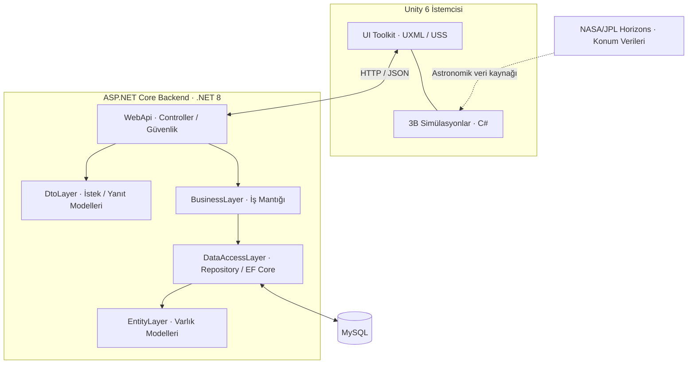
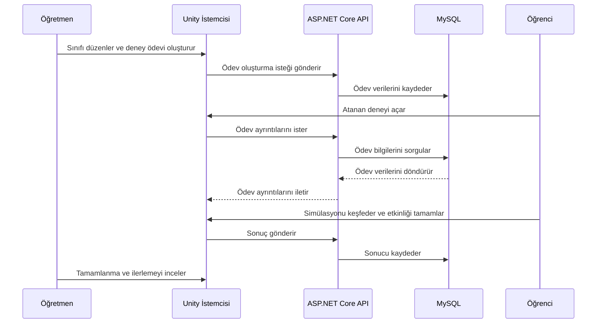

<div align="center">

# SCIENYX

### Etkileşimli Bilim Simülasyonları ve Eğitim Yönetim Platformu

**Keşfederek öğren. Deneyimleyerek öğret.**

Unity ile geliştirilen üç boyutlu bilim simülasyonlarını; ASP.NET Core tabanlı, katmanlı bir backend üzerinden sınıf, ödev ve öğrenci ilerlemesi yönetimiyle bir araya getiren akademik yazılım projesi.

[](https://unity.com/)
[](https://learn.microsoft.com/dotnet/csharp/)
[](https://dotnet.microsoft.com/)
[](https://learn.microsoft.com/aspnet/core/)
[](https://www.mysql.com/)
[](https://ssd.jpl.nasa.gov/horizons/)
[](#proje-durumu)

[Genel Bakış](#genel-bakis) · [Özellikler](#temel-ozellikler) · [NASA Verileri](#nasa-jpl-horizons-verileri) · [Mimari](#sistem-mimarisi) · [Görseller](#ekran-goruntuleri) · [Kurulum](#kurulum-ve-calistirma) · [Akademik Süreç](#akademik-surec)

</div>


---

<a id="genel-bakis"></a>
## Genel Bakış

**Scienyx**, fen ve astronomi konularını yalnızca metin ve görsellerle anlatmak yerine, kullanıcıların üç boyutlu simülasyonları keşfederek öğrenebilmesini hedefleyen bir eğitim yazılımıdır. Bilimsel olayların görselleştirilmesini sınıf ve ödev yönetiminden ayrı tutmak yerine, bu deneyimleri **tek bir masaüstü uygulamasında** bir araya getirir.

Öğrenciler Unity ortamında Güneş, Dünya ve Ay'ın hareketlerini inceleyebilir; öğretmenler sınıflarını düzenleyebilir, deney temelli ödevler atayabilir ve öğrencilerin ilerlemelerini takip edebilir. Yönetici paneli ise kullanıcı, rol ve platform faaliyetlerine yönelik yönetim ekranları sunar.

Uygulama; **3B simülasyon**, **Unity UI Toolkit**, **REST API entegrasyonu**, **ilişkisel veritabanı** ve **NASA/JPL Horizons kaynaklı gök cismi konum verilerini** aynı proje çatısı altında buluşturur.

> **Proje kapsamı:** Scienyx, eğitim amaçlı geliştirilmiş bir **akademik prototiptir**. Profesyonel astronomik tahmin hizmeti veya canlı kullanımda olduğu doğrulanmış bir eğitim platformu olarak sunulmamaktadır. Ekran görüntüleri, uygulamanın Unity Editor üzerinden çalıştırılmış hâlinden alınmıştır.

<a id="temel-ozellikler"></a>
## Temel Özellikler

### Etkileşimli bilim simülasyonları

- **Güneş ve Ay tutulması anlatımları:** Güneş, Dünya ve Ay'ın birbirine göre konumlarının, tam gölge (*umbra*) ve yarı gölge (*penumbra*) kavramlarının aşamalı gösterimi.
- **Güneş sistemi görselleştirmesi:** Güneş–Dünya–Ay sistemini ve yörüngesel ilişkilerini üç boyutlu ortamda inceleme.
- **NASA/JPL Horizons konum verileri:** Gök cisimlerinin konumlarını modellemek için [NASA Jet Propulsion Laboratory (JPL) Horizons](https://ssd.jpl.nasa.gov/horizons/) sisteminden alınan astronomik konum/efemeris verilerinden yararlanma.
- **Çoklu kamera açıları:** Genel görünüm, üstten görünüm, Güneş, Dünya ve Ay odaklı kamera perspektifleri.
- **Zaman denetimleri:** Tarih, saat ve simülasyon hızını değiştirerek modeli farklı zamanlarda gözlemleme.
- **Bilgilendirme panelleri:** Gök cisimlerinin özellikleri ve hareketleri hakkında açıklayıcı içerikler.
- **Sesli anlatım ve altyazı:** Yapay zekâ araçlarıyla üretilen seslendirmeleri, ekrandaki altyazılarla birleştiren eğitsel sahneler.

### Eğitim yönetimi

| Kullanıcı rolü | Uygulamada gösterilen işlevler |
| --- | --- |
| **Yönetici** | Kullanıcı ve rol yönetimi ekranları, genel platform istatistikleri, etkinlik ve sistem yönetimi bölümleri. |
| **Öğretmen** | Sınıf oluşturma ve yönetme, deney temelli ödev atama, etkinlik takibi, sınıf ve öğrenci performansını görüntüleme. |
| **Öğrenci** | Katıldığı sınıfları görme, ödevleri takip etme, tamamlanma ve ilerleme durumlarını inceleme, simülasyonlara erişme. |

Yukarıdaki işlevler, mevcut uygulama ekranlarında görülen üç temel rolü esas alır. Projenin tasarım geçmişinde farklı panel ve kullanıcı türlerine ilişkin çalışmalar da bulunmaktadır.

### Uygulama arayüzü

- **Unity UI Toolkit**, **UXML**, **USS** ve **C#** kullanılarak hazırlanmış özel arayüzler.
- Giriş yapma ve hesap oluşturma ekranları.
- Kullanıcı rolüne göre değişen menüler ve kontrol panelleri.
- Takvim, etkinlik akışı, istatistik kartları ve veri görselleştirme bileşenleri.
- ASP.NET Core Web API üzerinden alınan sınıf ve ödev bilgilerinin Unity arayüzünde gösterilmesi.

<a id="nasa-jpl-horizons-verileri"></a>
## NASA/JPL Horizons Verileri

Scienyx'in astronomi tarafında kullanılan önemli veri kaynaklarından biri **NASA/JPL Horizons** sistemidir. Horizons, Güneş Sistemi cisimlerinin farklı tarihlerdeki konum ve hareketlerine ilişkin efemeris verileri sunan bir hizmettir.

Projede bu kaynaktan **gezegen ve ilgili gök cisimlerinin konum verileri çekilerek** simülasyonun astronomik veri tarafında kullanılmaktadır. Böylece çalışma yalnızca önceden hazırlanmış sabit bir görsel sahneye dayanmaz; dış bir bilimsel veri kaynağından yararlanır.

**Kaynaklar:**

- [NASA/JPL Horizons — Resmî site](https://ssd.jpl.nasa.gov/horizons/)
- [NASA/JPL Horizons API — Teknik dokümantasyon](https://ssd-api.jpl.nasa.gov/doc/horizons.html)

> **Teknik not:** NASA/JPL'den efemeris verisi alınması, Unity sahnesindeki bütün mesafelerin, ölçeklerin ve tutulma gösterimlerinin fiziksel olarak doğrulandığı anlamına gelmez. Veri kaynağı ile görsel simülasyonun doğruluk düzeyi ayrı değerlendirilmelidir.

<a id="ekran-goruntuleri"></a>
## Ekran Görüntüleri

<details open>
<summary><strong>Uygulama ve yönetim panelleri</strong></summary>

| Giriş ekranı | Öğretmen kontrol paneli |
| :---: | :---: |
|  |  |
| **Yönetici kontrol paneli** | **Sınıf yönetimi** |
|  |  |
| **Öğrenci ödevleri** | **Güneş sistemi keşfi** |
|  |  |

</details>

<details>
<summary><strong>Tutulma simülasyonlarından sahneler</strong></summary>

| Güneş tutulması anlatımı | Ay tutulması ve gölge bölgeleri |
| :---: | :---: |
|  |  |

</details>

## Kullanılan Teknolojiler

| Alan | Teknolojiler | Kullanım amacı |
| --- | --- | --- |
| **Masaüstü uygulaması** | Unity 6, C# | 3B simülasyon, sahne yönetimi, uygulama akışı |
| **Kullanıcı arayüzü** | UI Toolkit, UXML, USS | Arayüz yerleşimi, stil ve etkileşimler |
| **Backend** | .NET 8, ASP.NET Core Web API | HTTP uç noktaları ve uygulama servisleri |
| **Veri erişimi** | Entity Framework Core, Pomelo | Veri eşleme, kalıcılık işlemleri ve migration yönetimi |
| **Veritabanı** | MySQL | Kullanıcı, sınıf ve ödev gibi uygulama verileri |
| **API araçları** | Swagger / OpenAPI | API dokümantasyonu ve yerel test |
| **Kimlik doğrulama altyapısı** | ASP.NET Core Identity, JWT paketleri | Kimlik doğrulama ve yetkilendirme bileşenleri |
| **Astronomik veri kaynağı** | NASA/JPL Horizons | Gök cismi konum ve efemeris verileri |
| **Eğitim medyası** | AI ile üretilmiş ses dosyaları, altyazılar | Sesli ve yazılı bilimsel anlatımlar |

> **Not:** Kimlik doğrulama paketlerinin projede bulunması, bütün giriş yöntemlerinin ve güvenlik kurallarının üretim ortamı için test edildiği anlamına gelmez. Bu README, akademik çalışmanın mevcut kapsamını anlatır.

<a id="sistem-mimarisi"></a>
## Sistem Mimarisi

Scienyx'te **Unity istemcisi**, **ASP.NET Core Web API** üzerinden backend ile iletişim kurar. Backend tarafında iş mantığı, veri erişimi, varlık modelleri ve veri transfer modelleri ayrı projelere bölünmüştür. Astronomik konum verileri için ayrıca **NASA/JPL Horizons** kaynağından yararlanılır.



**Mimari açıklaması:** Kesikli NASA/JPL bağlantısı, simülasyonda kullanılan **haricî veri kaynağını** ifade eder; API isteğinin Unity içinden mi yoksa başka bir katman üzerinden mi gerçekleştirildiğini tarif etmez.

### Proje klasör yapısı

```text
ExperimentSimulation/
├── backend/
│   ├── ExperimentSimulation.BusinessLayer/
│   │   ├── Abstract/
│   │   └── Concrete/
│   ├── ExperimentSimulation.DataAccessLayer/
│   │   ├── Abstract/
│   │   ├── Concrete/
│   │   ├── EntityFramework/
│   │   ├── Migrations/
│   │   ├── Repositories/
│   │   └── SeedData/
│   ├── ExperimentSimulation.DtoLayer/
│   ├── ExperimentSimulation.EntityLayer/
│   └── ExperimentSimulation.WebApi/
│       ├── Controllers/
│       ├── Dtos/
│       ├── Security/
│       ├── Program.cs
│       └── appsettings.json
├── unity/
│   └── ExperimentSim/
├── docs/
│   └── screenshots/
├── ExperimentSimulation.slnx
└── README.md
```

Bu katmanlı yapı, istek işleme, iş kuralları, veri erişimi ve kullanıcı arayüzü üzerinde ayrı ayrı çalışmayı kolaylaştırır. **Mikroservis mimarisi kullanıldığı anlamına gelmez.**

### Örnek API uç noktaları

Swagger dokümantasyonunda görüntülenen bazı uç noktalar:

| HTTP metodu | Uç nokta | Amaç |
| --- | --- | --- |
| `POST` | `/api/Auth/login` | Kullanıcı girişi |
| `GET` | `/api/Assignment/my` | Kullanıcının ödevlerini getirme |
| `POST` | `/api/Assignment` | Yeni ödev oluşturma |
| `POST` | `/api/AssignmentResult` | Ödev sonucu gönderme |
| `GET` | `/api/AssignmentResult/assignment/{assignmentId}/completed-students` | Bir ödevi tamamlayan öğrencileri listeleme |
| `GET` | `/api/AssignmentResult/{resultId}/answers` | Bir sonuca bağlı yanıtları getirme |
| `GET` | `/api/Calendar/categories` | Takvim kategorilerini getirme |

Bu tablo API'nin **tamamını değil, seçilmiş örneklerini** içerir. Geliştirme ortamında OpenAPI etkinleştirildiğinde API, Swagger UI üzerinden incelenebilir.

<a id="kurulum-ve-calistirma"></a>
## Kurulum ve Çalıştırma

> Bu adımlar, kaynak kodu yerel ortamında çalıştırmak isteyen geliştiriciler içindir. MySQL servisinin çalışıyor olması ve projeye uygun bağlantı ayarlarının yapılması gerekir.

### Gereksinimler

- **.NET SDK 8** ve Visual Studio veya uyumlu bir C# geliştirme ortamı. `.slnx` dosyasını doğrudan `dotnet` komutuyla kullanmak için **SDK 9.0.200 veya üzeri** gerekebilir.
- **Unity Hub** ve uyumlu bir **Unity 6** sürümü (görseller Unity 6.3 LTS ile alınmıştır).
- EF Core sağlayıcısıyla uyumlu **MySQL Server**.
- **Git**.

### 1. Depoyu klonlayın

```bash
git clone https://github.com/iremcebeci/ExperimentSimulation.git
cd ExperimentSimulation
```

### 2. Backend yapılandırmasını tamamlayın

`Program.cs` ve `DbContext` tarafından beklenen **veritabanı bağlantı bilgilerini** ve **kimlik doğrulama ayarlarını** geliştirme ortamınıza uygun biçimde tanımlayın. Gerçek veritabanı şifrelerini veya JWT gizli anahtarlarını Git deposuna eklemeyin; ortam değişkenleri, yerel yapılandırma veya .NET User Secrets kullanın.

Bağımlılıkları geri yükleyin:

```bash
dotnet restore backend/ExperimentSimulation.WebApi/ExperimentSimulation.WebApi.csproj
```

EF Core migration dosyaları veri erişim katmanında, başlangıç uygulaması ise Web API projesindedir. Veritabanı güncellemesi için:

```bash
dotnet ef database update --project backend/ExperimentSimulation.DataAccessLayer --startup-project backend/ExperimentSimulation.WebApi
```

`dotnet ef` komutu tanınmıyorsa projeyle uyumlu EF Core CLI aracını yükleyin. Migration'ların çalışması için doğru veritabanı kimlik bilgileri ve tasarım zamanında oluşturulabilen bir `DbContext` gerekir.

### 3. API'yi başlatın

```bash
dotnet run --project backend/ExperimentSimulation.WebApi
```

Geliştirme ortamında etkinse Swagger dokümantasyonuna aşağıdaki adres şablonundan erişebilirsiniz:

```text
http://localhost:<api-port>/swagger
```

### 4. Unity projesini açın

1. **Unity Hub** uygulamasını açın ve **Add project from disk** seçeneğini kullanın.
2. `unity/ExperimentSim/` klasörünü seçin.
3. Projeyi uyumlu bir **Unity 6** sürümüyle açın.
4. Unity istemcisindeki API temel adresini çalışan yerel backend adresine göre yapılandırın (ilgili istemci ayarları veya script'ler üzerinden).
5. İlgili sahneyi açıp **Play Mode** ile çalıştırın.

> Depoda herkese açık bir API sunucusu veya hazır çalıştırılabilir sürüm bulunduğu varsayılmamalıdır. Yerel çalıştırma, projeye özel ek ayarlar gerektirebilir.

## Örnek Eğitim Süreci



Diyagram, hedeflenen uçtan uca eğitim akışını özetler; sistemin bağımsız bir üretim ortamında doğrulandığı iddiasını taşımaz.

<a id="akademik-surec"></a>
## Akademik Süreç

Scienyx, **iki aşamalı bir ders projesi** olarak geliştirilmiştir:

- **Yönlendirilmiş Çalışma I:** Projenin ilk analizi, planlaması ve dokümantasyonunun hazırlanması.
- **Yönlendirilmiş Çalışma II:** Yazılımın geliştirilmesi, Unity simülasyonlarının hazırlanması, kullanıcı arayüzleri ve backend entegrasyonu.

Bu çalışma; **nesne yönelimli programlama**, **3B simülasyon geliştirme**, **UI mühendisliği**, **REST API**, **ilişkisel veritabanları** ve **haricî bilimsel verilerin yazılımda kullanımı** gibi farklı konuları aynı eğitim senaryosunda birleştirmektedir.

Yönlendirilmiş Çalışma I kapsamında hazırlanan ilk proje raporunun yayımlanabilir sürümü depoya eklendiğinde bu bölümden bağlantı verilebilir.

<a id="proje-durumu"></a>
## Proje Durumu

**Akademik prototip / yazılım geliştirici portföy projesi.**

Görseller, geliştirilmiş arayüzleri, backend'den gelen eğitim verilerini ve bilimsel simülasyon sahnelerini göstermektedir. Üretim ortamında kullanım öncesinde tüm özelliklerin uçtan uca test edilmesi, hata yönetimi, grafik verilerinin doğrulanması, otomatik testler, dağıtım dokümantasyonu ve astronomik modelin doğruluk değerlendirmesi gibi alanlarda ek çalışma yapılabilir.

Anlatım sahnelerinde **yapay zekâ ile oluşturulmuş ses dosyaları ve bunlara eşlik eden altyazılar** kullanılmıştır. Bu özellik, uygulamanın içinde çalışan üretken yapay zekâ modeli veya yapay zekâ destekli backend bulunduğu iddiası değildir.

## Depo Bilgileri

- **Kaynak kod:** [iremcebeci/ExperimentSimulation](https://github.com/iremcebeci/ExperimentSimulation)
- **Platform:** Unity masaüstü istemcisi + ASP.NET Core Web API
- **Astronomik veri kaynağı:** [NASA/JPL Horizons](https://ssd.jpl.nasa.gov/horizons/)
- **Amaç:** Eğitim yazılımı geliştirme ve teknik portföy

---

<div align="center">

**Scienyx — Bilimi her simülasyonda biraz daha keşfedilebilir kılmak.**

</div>
